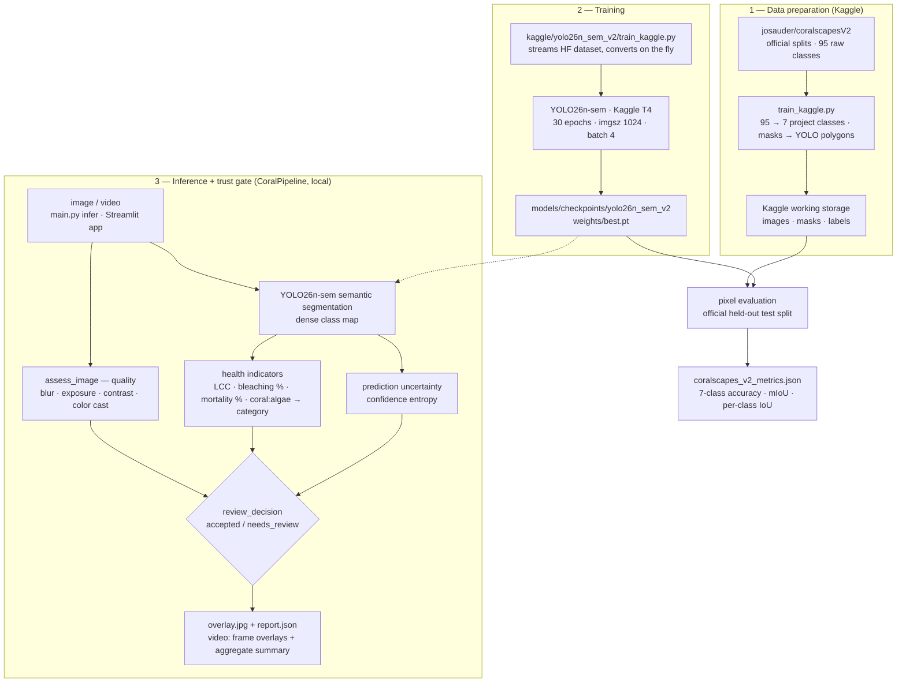

# Trustworthy AI-Assisted Coral Reef Health Assessment

A reproducible image/video workflow for visible benthic composition and coral-condition indicators. Every result carries image-quality checks, predicted coverage, confidence/uncertainty signals, and an explicit `accepted` or `needs_review` state. The 7-class pipeline is served by four interchangeable V2 backends (YOLO26n-sem, YOLO26n-seg, SegFormer-B5, DINOv3-DPT) alongside the legacy 7-class instance pipeline — summarised in [Workflows at a glance](#workflows-at-a-glance) and [Model states](#model-states-and-measured-performance).

Scope: quantitative visible benthic composition and coral-condition indicators with automated reliability verification.

---

## Table of contents

1. [Workflows at a glance](#workflows-at-a-glance)
2. [Quick start](#quick-start)
3. [Architecture](#architecture)
4. [Current artifacts](#current-artifacts-and-v2-migration)
5. [Dataset](#dataset)
6. [Entry point: `main.py`](#entry-point-mainpy)
7. [Data preparation](#data-preparation)
8. [Training (Kaggle Cloud Workflow)](#training-kaggle-cloud-workflow)
9. [Condition classifier](#condition-classifier)
10. [Evaluation & Model Comparisons](#evaluation)
    - [V2 head-to-head: four backends](#v2-head-to-head-four-backends)
    - [YOLO26n-seg V1 vs V2 & Semantic Models](#yolo26n-seg-v1-vs-v2--semantic-models)
    - [Instance Segmentation (`seg`) vs. Semantic Segmentation (`sem`)](#instance-segmentation-seg-vs-semantic-segmentation-sem)
11. [Inference & reef health pipeline](#inference--reef-health-pipeline)
12. [Trust / reliability gate](#trust--reliability-gate)
13. [Overlay and video aggregation](#overlay-and-video-aggregation)
14. [Streamlit UI](#streamlit-ui)
15. [Repository layout](#repository-layout)
16. [Reproducibility record](#reproducibility-record)
17. [Glossary & Terminology](#glossary--terminology)

---

## Workflows at a glance

The repo ships **two inference workflows**. Both run through the same reliability gate, overlay, video aggregation, and Streamlit UI; they differ in model, taxonomy, and measured metrics.

| | Workflow 1 — instance (V1) | Workflow 2 — semantic & multi-backend (V2) |
|---|---|---|
| Checkpoint | `models/checkpoints/yolo26n_seg/weights/best.pt` | `models/checkpoints/yolo26n_sem_v2/weights/best.pt`, `yolo26n_seg_v2`, SegFormer-B5 or DINOv3-DPT under `models/pretrained/` |
| Weights | committed (Git LFS) | YOLO checkpoints committed (Git LFS); SegFormer/DINOv3 fetched with `scripts/fetch_pretrained.py` |
| Task | 7-class **instance** segmentation | 7-class **semantic** or **instance** segmentation |
| Extra model | ResNet18 crop condition classifier (`condition_resnet18.pt`) | none — visible condition is a native segmentation class |
| Backends | YOLO26n-seg | YOLO26n-sem, YOLO26n-seg, SegFormer-B5 **or** DINOv3 ViT-L + DPT (interchangeable) |
| CLI | `python main.py infer` (default) | `python main.py infer --model <v2-ckpt>`; add `--model-type segformer` or `--model-type dinov3` |
| Taxonomy | `src/data/label_map.py` (39 → 7) | `configs/labels.yaml` + `src/data/v2_label_map.py` (95 → 7) |
| Held-out split | 392 images (Coralscapes V1) | 473 images (official CoralscapesV2 test) |
| Report | `reports/segmentation_metrics.json` | `reports/yolo26n_sem_vs_segformer_b5_coralscapesv2.{md,json}` |

### Model states and measured performance

All four V2 backends are trained and available. The fine-tuned checkpoints are versioned with the repository through Git LFS; the two public EPFL-ECEO backbones are downloaded by `scripts/fetch_pretrained.py`.

| Model | Checkpoint | State | Size |
|---|---|---|---:|
| DINOv3 ViT-L + DPT (95-class) | `models/pretrained/coralscapesv2-dinov3-vitl-lora-dpt-95_class/` | fetch from Hugging Face | 1.33 GB |
| SegFormer-B5 (95-class) | `models/pretrained/segformer-b5-coralscapesv2-95/` | fetch from Hugging Face | 339 MB |
| YOLO26n-sem, 7-class | `models/checkpoints/yolo26n_sem_v2/weights/best.pt` | committed (LFS) | 3.3 MB |
| YOLO26n-seg, 7-class | `models/checkpoints/yolo26n_seg_v2/weights/best.pt` | committed (LFS) | 6.4 MB |
| YOLO26n-seg, 7-class (V1) | `models/checkpoints/yolo26n_seg/weights/best.pt` | committed (LFS) | 6.3 MB |
| ResNet18 condition (V1 only) | `models/checkpoints/condition_resnet18.pt` | committed (LFS) | 43 MB |

`weights/last.pt` files are training-resume artefacts and are git-ignored; `weights/best.pt` is the versioned deliverable.

**Segmentation — 473-image official CoralscapesV2 test split, 7-class, FP32:**

| Backend | Pixel accuracy | Macro mIoU | Inference |
|---|---:|---:|---:|
| DINOv3 ViT-L + DPT | **87.20%** | **72.65%** | 3.58 s/image |
| SegFormer-B5 | 85.36% | 67.87% | 1.30 s/image |
| YOLO26n-sem | 75.64% | 51.94% | 0.026 s/image |
| YOLO26n-seg | 52.32% | 41.04% | 0.032 s/image |

Macro mIoU is pooled over all valid pixels in the split. YOLO26n-seg's map is a rasterisation of instance masks, so its dense score is structurally penalised; see [What is and is not comparable](#what-is-and-is-not-comparable).

**Health output — compared with labels derived from the ground-truth masks:**

| Backend | Live-cover MAE | Live-cover bias | Verdict agreement | Within 1 tier |
|---|---:|---:|---:|---:|
| DINOv3 ViT-L + DPT | **2.99 pts** | +0.03 | **80.5%** | **98.5%** |
| SegFormer-B5 | 3.87 pts | +1.17 | 77.8% | 97.5% |
| YOLO26n-sem | 7.16 pts | +2.35 | 64.5% | 93.2% |
| YOLO26n-seg | 23.34 pts | +22.67 | 47.8% | 81.0% |

These measure the product output rather than segmentation overlap: live-coral-cover error, agreement of the combined `reef_health_category`, and how often the predicted tier is within one band. They are computed from the cached 7-class prediction maps against GT-mask-derived labels, not field surveys.

**Health-verdict rule.** The verdict is the live-cover tier capped by coral condition (bleaching or mortality ≥ 10/25/50% of all coral caps the tier at Good/Fair/Poor/Degraded). The cap changed the reported tier on 6.8% (DINOv3), 7.8% (SegFormer), 8.7% (YOLO26n-sem) and 12.9% (YOLO26n-seg) of test images — precisely the cases where cover alone contradicted the model's own bleaching warning. Agreement is a little lower than the cover-only rule it replaced because the verdict now also depends on the weaker `coral_bleached`/`dead_coral` masks. The uncapped cover tier remains available as `live_cover_tier`, with `coral_condition` and `condition_cap` exposing the cause.

**Workflow 1 baseline** — 392-image test split at conf 0.20: **mIoU 40.38%**, pixel accuracy 74.37%, ECE 0.375, mask mAP50 16.52%. The ResNet18 condition classifier scores 38.22% accuracy / 22.64% macro F1 and is treated as an advisory signal, not ground truth.

### What is and is not comparable

- **The four V2 backends are comparable to each other**: same test split, same 7-class mapping, same evaluator (`scripts/evaluate_v2_model_comparison.py`). DINOv3-DPT wins on accuracy and mIoU; YOLO26n-sem is ~120× faster.
- **YOLO26n-seg is only loosely comparable**: its dense map is a rasterisation of instance masks at conf 0.25 over connected-component instances, not a per-pixel classifier over per-colony labels.
- **Dense backends report pixel confidence, not detection confidence**: SegFormer/DINOv3 return the probability of the chosen class plus a mean normalised entropy, and their overlay boxes are region boxes around connected coral components — not per-colony instances. YOLO26n-sem exposes class IDs only, so its confidence is reported as unavailable rather than as a fabricated zero.
- **Inference timings** are single-image, batch 1, FP32, with the model already loaded; image I/O and process startup are excluded.
- **Workflow 1 vs Workflow 2 is not comparable**: different class taxonomies and different test splits (392 vs 473).
- **Published CoralscapesV2 benchmarks are not comparable** either: they report the native 95-class or 39-class label sets. The 7-class fold is a coarsening, so its mIoU is higher by construction.
- `kaggle/yolo26n_seg_v2/` is the instance run: V1's instance workflow retrained on instances derived from V2 semantic masks (connected components, not per-colony labels). Test mask mAP50 0.2605 / mAP50-95 0.1355, 41.04% mIoU / 52.32% pixel accuracy as a rasterised dense map.
- Everything here runs FP32. SegFormer under CUDA FP16 autocast produced NaN logits that collapsed the map to class 0 on this GPU; FP32 is both correct and faster.

---

## Quick start

### A. Use the trained checkpoints

All fine-tuned checkpoints ship with the repository through Git LFS, so a fresh clone can run both workflows. Run `git lfs install` once per machine **before** cloning; if you already cloned without it, `git lfs pull` restores the weights. The two public backbones are downloaded once:

```bash
git lfs install                      # once per machine
python -m pip install -r requirements.txt
python scripts/fetch_pretrained.py   # SegFormer + DINOv3 (~1.6 GB)

# Single image (writes overlay.jpg + report.json to outputs/inference/)
python main.py infer --image path/to/image.jpg

# Video analysis (extracts frames, generates annotated_survey.mp4 and report.json)
python main.py infer --video path/to/video.mp4 --out outputs/video_analysis --every-n 15

# Workflow 2 (V2) — YOLO26n-sem backend (recommended edge semantic, ~38 FPS)
python main.py infer --model models/checkpoints/yolo26n_sem_v2/weights/best.pt --image path/to/image.jpg --out outputs/v2_sem

# Workflow 2 (V2) — YOLO26n-seg backend (native 7-class instance, ~31 FPS)
python main.py infer --model models/checkpoints/yolo26n_seg_v2/weights/best.pt --image path/to/image.jpg --out outputs/v2_seg

# Workflow 2 (V2) — SegFormer-B5 backend
python main.py infer --model-type segformer --model models/pretrained/segformer-b5-coralscapesv2-95 --image path/to/image.jpg --out outputs/segformer

# Workflow 2 (V2) — DINOv3 ViT-L + DPT backend (highest accuracy)
python main.py infer --model-type dinov3 --model models/pretrained/coralscapesv2-dinov3-vitl-lora-dpt-95_class --image path/to/image.jpg --out outputs/dinov3

# Streamlit UI
python main.py app
```

See [Workflows at a glance](#workflows-at-a-glance) for how the two workflows and their four V2 backends differ.

The legacy V1 crop classifier loads only with the V1 model. V2 predicts supported visible condition classes directly; its default workflow does not use the old crop classifier.

### B. Get the pretrained backbones

SegFormer-B5 and DINOv3-DPT are public but too large to commit (~1.6 GB together). The helper fetches both into the paths the CLI expects:

```bash
python scripts/fetch_pretrained.py              # both (~1.6 GB)
python scripts/fetch_pretrained.py --only segformer
python scripts/fetch_pretrained.py --only dinov3
```

Equivalent manual download with the Hugging Face CLI:

```bash
hf download EPFL-ECEO/segformer-b5-finetuned-coralscapesv2-1024-1024-95_class \
  --local-dir models/pretrained/segformer-b5-coralscapesv2-95

hf download EPFL-ECEO/coralscapesv2-dinov3-vitl-lora-dpt-95_class \
  --local-dir models/pretrained/coralscapesv2-dinov3-vitl-lora-dpt-95_class

# DINOv3 ships num_classes=96 but no label names; the 96->7 fold is name-based.
cp configs/dinov3_id2label.json \
   models/pretrained/coralscapesv2-dinov3-vitl-lora-dpt-95_class/id2label.json
```

Both repositories are public, so no token or login is required. Expected footprint: SegFormer **339 MB**, DINOv3 **1.33 GB**. Re-running the fetch only downloads missing files. Verify with:

```bash
ls models/pretrained/*/model.safetensors
```

The gated `facebook/dinov3-vitl16-pretrain-lvd1689m` repo is **not** needed: the encoder architecture is rebuilt from the checkpoint's own tensor shapes.

### C. Full setup (reproduce the artifacts)

The datasets and prepared data are **not tracked in git** (too large). The V1 and V2 YOLO checkpoints ship with the repo (LFS); retrain either on Kaggle to reproduce them, and fetch the pretrained backbones with `scripts/fetch_pretrained.py`.

```bash
python -m pip install -r requirements.txt

# 1. Train V2 on Kaggle. The kernel downloads/streams the semantic splits there;
#    no local copy of the 6.75 GB source dataset is required.
kaggle kernels push -p kaggle/yolo26n_sem_v2/
kaggle kernels output <your-kaggle-username>/coral-btp-yolo-sem -p outputs/kaggle/yolo26n_sem_v2/
mkdir -p models/checkpoints/yolo26n_sem_v2/weights
cp outputs/kaggle/yolo26n_sem_v2/checkpoints/yolo26n_sem_coralscapes_v2/weights/best.pt models/checkpoints/yolo26n_sem_v2/weights/best.pt

# The Kaggle output also contains coralscapes_v2_metrics.json, computed on the
# official test split after training. Review it before using the checkpoint.

# 2. Sample inference after training
python main.py infer --model models/checkpoints/yolo26n_sem_v2/weights/best.pt --image path/to/reef.jpg --out outputs/final_sample
```

For a local V2 preparation/evaluation workflow, download the semantic data and run `python main.py prepare-v2`, then `python main.py evaluate-v2`. This optional route needs several gigabytes of local disk space.

Training and held-out metrics are produced by the Kaggle kernel described in [Training (Kaggle Cloud Workflow)](#training-kaggle-cloud-workflow).

## Architecture

Three stages: Kaggle downloads and prepares the data, trains and evaluates the model; local inference runs through the trust/reliability gate.



The diagram traces **Workflow 2** (7-class semantic). **Workflow 1** reuses stages 2–3 unchanged: it substitutes the YOLO26n-seg 7-class checkpoint and the optional ResNet18 crop condition classifier for the semantic model, then feeds the same health-indicator and trust-gate code.

## Current artifacts and V2 migration

- **Legacy V1 checkpoint**: `models/checkpoints/yolo26n_seg/weights/best.pt` (7 classes; kept as the reproducible baseline, committed via Git LFS)
  - Kaggle T4, 30 epochs, imgsz 512, batch 16, full Coralscapes training set (1,517 train images)
  - Mask mAP50 ≈ 0.165 on the val split (from `models/checkpoints/yolo26n_seg/results.csv`)
  - Operating mIoU ≈ 0.404 at conf 0.20 on the full 392-image test split, with Expected Calibration Error ECE ≈ 0.375
- **Condition classifier**: `models/checkpoints/condition_resnet18.pt` (committed via Git LFS)
  - Legacy V1 ResNet18 crop classifier. V2 predicts visible condition in the segmentation classes and does not load this older classifier by default.
- **V1 evaluation report**: `reports/segmentation_metrics.json` — 392-image V1 test split at conf 0.20 (mIoU ≈ 0.404, ECE ≈ 0.375; this does not measure the V2 model)
- **Training record**: `reports/training_run.json`
- **V2 setup**: `configs/labels.yaml` (7-class project taxonomy), `configs/label_map.json` (explicit 95-to-7 map), and `src/data/v2_label_map.py` define the semantic workflow. `models/checkpoints/yolo26n_sem_v2/weights/best.pt` and `yolo26n_seg_v2/weights/best.pt` are the 7-class Kaggle runs retrained on this taxonomy, both committed via Git LFS; retrain via `kaggle/yolo26n_sem_v2/train_kaggle.py` or `kaggle/yolo26n_seg_v2/train_kaggle.py`. V1 artifacts are untouched.
- **SegFormer baseline**: `models/pretrained/segformer-b5-coralscapesv2-95/` — the CoralscapesV2 SegFormer-B5 model from `EPFL-ECEO/segformer-b5-finetuned-coralscapesv2-1024-1024-95_class`, downloaded by `scripts/fetch_pretrained.py`. Selected at inference with `--model-type segformer`.
- **DINOv3 baseline**: `models/pretrained/coralscapesv2-dinov3-vitl-lora-dpt-95_class/` — `EPFL-ECEO/coralscapesv2-dinov3-vitl-lora-dpt-95_class`, the best-performing published CoralscapesV2 model, downloaded by `scripts/fetch_pretrained.py` together with the 95-class `id2label.json` from `configs/dinov3_id2label.json`. Selected with `--model-type dinov3`; the encoder architecture is rebuilt from the checkpoint itself, so the gated Facebook repo is not needed.
- **V2 comparison report**: `reports/yolo26n_sem_vs_segformer_b5_coralscapesv2.{md,json}` — four backends on the 473-image official test split.
- **V2 instance run**: `models/checkpoints/yolo26n_seg_v2/weights/best.pt` (committed via Git LFS) — V1's instance workflow retrained on instances derived from V2 semantic masks (connected components, not per-colony labels). Test mask mAP50 0.2605, mAP50-95 0.1355; 41.04% mIoU / 52.32% pixel accuracy as a rasterised dense map.
- **Prepared V2 dataset**: generated on demand by `python main.py prepare-v2` → `data/processed/v2_yolo/` (not tracked in git; the Kaggle kernels stream the dataset instead)

## Dataset

- V2 source: `josauder/coralscapesV2` (Apache-2.0), 2,433 annotated images and 95 raw semantic labels. The `default` config (semantic masks) is what the training kernels stream; the dataset also ships an `instances` config with panoptic `instance_ids`, which the current YOLO26n-seg V2 run does **not** use yet (it derives instances from connected components instead).
- Local snapshot: optional `data/raw/coralscapes_v2/`; the Kaggle kernels stream the Parquet shards, so no local copy is required.
- Project taxonomy: 7 classes in `configs/labels.yaml` — `coral_alive`, `coral_bleached`, `dead_coral`, `algae`, `hard_substrate`, `sand`, `non_reef`. The split is taxonomy-free (no genus names) and keeps only visible condition. Every one of the 95 source labels is mapped explicitly in `configs/label_map.json`.
- Health ratios use **reef classes only**; the `non_reef` discard sink is excluded from the denominator and reported separately. Non-coral animals, people/equipment, trash, water, and dark/background are routed to `non_reef` so they cannot leak into coral or algae cover.
- The earlier V1 39-to-7 mapping remains in `src/data/label_map.py` for the baseline.

## Entry point: `main.py`

Every command-line workflow is funneled through `main.py`:

```bash
python main.py prepare [--root DATASETS_HF] [--out PROCESSED] [--max-images-per-split N] [--copy-images]
python main.py prepare-v2 [--root data/raw/coralscapes_v2] [--out data/processed/v2_yolo] [--max-images-per-split N]
python main.py evaluate [--model CKPT] [--manifest ...] [--raw-classes ...] [--max-images N] [--conf ...] [--out ...]
python main.py evaluate-v2 [--model CKPT] [--manifest ...] [--raw-classes ...] [--max-images N] [--conf ...] [--out ...]
python main.py infer [--model CKPT] [--model-type yolo|segformer|dinov3] [--condition-model CKPT] [--image IMG | --video VID] [--out DIR] [--imgsz 512] [--conf ...] [--every-n N] [--max-frames N] [--save-frames] [--output-video-name NAME]
python main.py train-condition [--manifest ...] [--raw-classes ...] [--crops ...] [--checkpoint ...] [--per-class N] [--epochs N] [--batch N]
python main.py app [--port 8501]
```

The legacy `evaluate` and `infer` defaults still point to the V1 checkpoint. Pass `models/checkpoints/yolo26n_sem_v2/weights/best.pt` explicitly (or `--model-type segformer|dinov3`) to run the V2 workflow; the checkpoints ship with the repo.

- `prepare` calls `src/data/prepare.py:prepare()` — converts the local HF Coralscapes snapshot into the YOLO segmentation dataset (manifest.csv, data.yaml, label_map.json, classes.json, YOLO polygon labels).
- `prepare-v2` calls `src/data/prepare.py:prepare_v2()` — converts the V2 semantic Parquet snapshot into the project-taxonomy (7-class) YOLO dataset.
- `evaluate` calls `src/evaluate/segmentation.py:evaluate()` — per-class IoU, mIoU, confusion matrix.
- `evaluate-v2` calls `src/evaluate/segmentation.py:evaluate_v2()` — V2 per-class IoU and mIoU, with missed foreground predictions counted as false negatives.
- `infer` calls `src/inference/pipeline.py:CoralPipeline` for image or video, writes overlay + JSON report.
- `train-condition` is a legacy V1 workflow: crop extraction + ResNet18 training. V2 condition labels are predicted directly by the segmentation model.
- `app` launches `src/app/streamlit_app.py` as a Streamlit sub-process.

Training itself no longer runs in a local script; it is the Kaggle kernel defined in `kaggle/`. The `scripts/` directory holds the local model-comparison evaluation.

## Data preparation

V2 entry point: `python main.py prepare-v2` → `src/data/prepare.py:prepare_v2()`

Reads `id2label.json` and split Parquet files from `data/raw/coralscapes_v2/data/{train,validation,test}-*.parquet`. Each sample row decodes RGB image bytes and the original V2 mask:
- For each sample, it produces:
  - `data/processed/v2_yolo/images/<split>/<stem>.png` (RGB image)
  - `data/processed/v2_yolo/masks/<split>/<stem>.png` (raw 95-class mask)
  - `data/processed/v2_yolo/labels/<split>/<stem>.txt` (polygons for the 7 project classes)
- Automatically emits:
  - `manifest.csv` (Sample index with paths, split, and polygon counts)
  - `data.yaml` (Ultralytics dataset configuration)
  - `label_map.json` (V2 raw-label to project-class mapping)
  - `classes.json` (V2 raw class names)

The project mapping is declared in `configs/label_map.json`: coral taxa are collapsed by visible state (`alive`/`bleached`/`dead`), algae-covered coral and substrate map to `algae`, substrate is split into hard substrate and sand, and non-reef scene content maps to the `non_reef` discard sink. Nothing maps to 255 for the V2 dataset.

## Training (Kaggle Cloud Workflow)

The V2 trainers run on Kaggle GPU: the scripts stream CoralscapesV2 splits directly from Hugging Face into Kaggle temporary storage, map masks into the 7 project classes, train Ultralytics backends (YOLO26n-sem or YOLO26n-seg) for 30 epochs, and evaluate on the official 473-image test split. The V1 checkpoint and its training run remain a separate baseline.

**Kernel repositories** (`kaggle/`):

- **YOLO26n-sem** (`kaggle/yolo26n_sem_v2/`, slug `nahilr/coral-btp-yolo-sem`): trains directly on dense class-ID PNG masks at `imgsz=1024`, `batch=4` from base `yolo26n-sem.pt`. Produces native 7-class semantic checkpoints (`best.pt`, 3.4 MB) and `coralscapes_v2_metrics.json` (75.64% pixel acc, 51.94% mIoU).
- **YOLO26n-seg** (`kaggle/yolo26n_seg_v2/`, slug `nahilr/coral-btp-yolo-seg`): trains on connected-component instance polygons derived from 7-class masks at `imgsz=1024`, `batch=4` from base `yolo26n-seg.pt`. Produces native 7-class instance checkpoints (`best.pt`, 6.6 MB) and `coralscapes_v2_yolo_seg_metrics.json` (26.05% mask mAP50, 41.04% mIoU).

**Retrain from scratch** (Kaggle CLI install + API token setup: [Kaggle API docs](https://github.com/Kaggle/kaggle-api)):

```bash
# Push & run semantic trainer:
kaggle kernels push -p kaggle/yolo26n_sem_v2/
kaggle kernels status <your-kaggle-username>/coral-btp-yolo-sem    # poll until complete
kaggle kernels output <your-kaggle-username>/coral-btp-yolo-sem -p outputs/kaggle/yolo26n_sem_v2/
cp outputs/kaggle/yolo26n_sem_v2/checkpoints/yolo26n_sem_coralscapes_v2/weights/best.pt models/checkpoints/yolo26n_sem_v2/weights/best.pt

# Push & run instance trainer:
kaggle kernels push -p kaggle/yolo26n_seg_v2/
kaggle kernels status <your-kaggle-username>/coral-btp-yolo-seg    # poll until complete
kaggle kernels output <your-kaggle-username>/coral-btp-yolo-seg -p outputs/kaggle/yolo26n_seg_v2/
cp outputs/kaggle/yolo26n_seg_v2/checkpoints/yolo26n_seg_coralscapes_v2/weights/best.pt models/checkpoints/yolo26n_seg_v2/weights/best.pt
```

After download, evaluate locally with `scripts/evaluate_v2_model_comparison.py` or run single-model evaluation via `python main.py evaluate-v2 --model <checkpoint>`. Inference accepts the model paths via `python main.py infer --model ...`.

---

## Condition classifier

Legacy checkpoint: `models/checkpoints/condition_resnet18.pt` — torchvision ResNet18 trained
from scratch on 128×128 crops sampled from Coralscapes V1 masks (`coral_alive`,
`coral_bleached`, `coral_dead`).

The current checkpoint was produced with (all defaults):

```bash
python main.py train-condition --per-class 250 --epochs 1 --batch 32
```

which runs `make_crops()` then `train_condition()`, both in `src/models/train_condition.py`:

- `make_crops()` draws up to 2 crops per image per class from the segmentation masks,
  capped at 250 crops per class per split (seed 42) → 450 train / 382 val crops under
  `data/processed/condition_crops/`.
- `train_condition()` trains ResNet18 from scratch with AdamW (lr 1e-3,
  weight decay 1e-4) on 128×128 inputs.

Current performance is modest — 38.22% accuracy, macro F1 ≈ 0.23, balanced accuracy ≈ 0.34 on the 382
validation crops, with `coral_dead` never predicted correctly (full metrics in
`reports/training_run.json`). Its crop-level votes are therefore treated as an
advisory signal alongside the segmentation masks, not as ground truth.

Full option set: `python main.py train-condition [--manifest ...] [--raw-classes ...] [--crops ...] [--checkpoint ...] [--per-class N] [--epochs N] [--batch N]`.

## Evaluation

Entry point: `python main.py evaluate` → `src/evaluate/segmentation.py:evaluate()`

For each row in `manifest.csv` (filtered to `split == "test"`, optionally truncated by `--max-images N`):

1. Load the image with cv2 and the raw mask via `broad_mask()` to get broad ground-truth class IDs.
2. Predict with Ultralytics at `imgsz=512` matching the model training resolution.
3. Produce a confusion matrix: unsegmented valid pixels are mapped to `other` to account for recall.
4. Compute per-class IoU, mean IoU (mIoU), and Expected Calibration Error (ECE) across detection confidences.

Report schema: `images`, `confidence_threshold`, `mIoU`, `per_class_iou`, `calibration` (binned reliability stats), and `confusion_matrix`.

The legacy V1 report was produced with the full 392-image test split at conf 0.20:

```bash
python main.py evaluate
```

For the V2 checkpoint and 7-class mapping, use `python main.py evaluate-v2 --out <path>`. The canonical 473-image V2 result is the four-backend report `reports/yolo26n_sem_vs_segformer_b5_coralscapesv2.{md,json}`; do not compare its mIoU directly with the V1 7-class score (see [What is and is not comparable](#what-is-and-is-not-comparable)).

### V2 head-to-head: four backends

`scripts/evaluate_v2_model_comparison.py` evaluates the four V2 backends (`--models yolo,yolo_seg,segformer,dinov3`) on the same 473-image official test split with identical class mapping and writes `reports/yolo26n_sem_vs_segformer_b5_coralscapesv2.{md,json}` (per-class IoU, confusion matrices, protocol notes, and aggregate inference timing; a fully cached rerun records `null` timings). Use this script, not `evaluate-v2`, when comparing backends: it resolves the 95 output labels of the dense models through their `id2label`, sums fine probabilities into the project classes, and counts void output as a missed prediction. Headline numbers are in [Workflows at a glance](#workflows-at-a-glance).

`--max-images N` is only a pipeline smoke test: it takes the *first N manifest rows* (not a random sample), whose composition is atypical, so subset metrics are not representative and should not be quoted as model performance.

### YOLO26n-seg V1 vs V2 & Semantic Models

A direct comparison between the original **YOLO26n-seg V1** baseline and the native 7-class models (**YOLO26n-seg V2** and the edge-semantic **YOLO26n-sem V2**):

#### Headline Metrics

| Metric / Dimension | **YOLO26n-seg (V1)** | **YOLO26n-seg (V2)** | **YOLO26n-sem (V2)** *(Dense Edge)* |
|---|:---:|:---:|:---:|
| **Dataset & Split** | Coralscapes V1 (392 test images) | CoralscapesV2 (473 test images) | CoralscapesV2 (473 test images) |
| **Input Resolution** | 512 × 512 | 1024 × 1024 | 1024 × 1024 (aspect-preserved) |
| **Model Size** | 6.5 MB | 6.6 MB | 3.4 MB |
| **Task Paradigm** | Instance polygon masks | Instance polygon masks | Dense per-pixel classification |
| **Mask mAP@50** | 16.52% | **26.05%** (+9.53 pts) | *N/A (semantic)* |
| **Mask mAP@50-95** | — | **13.55%** | *N/A (semantic)* |
| **Macro mIoU** | 40.38% | **41.04%** (+0.66 pts) | **51.94%** (+11.56 pts) |
| **Pixel Accuracy** | 74.37% | 52.32% *(see note below)* | **75.64%** (+1.27 pts) |
| **Inference Latency** | ~25 ms | ~32 ms (~31 FPS) | **~26 ms (~38 FPS)** |
| **Condition Pipeline** | Required ResNet-18 crop classifier | **Native** (no secondary classifier) | **Native** (no secondary classifier) |

#### Per-Class IoU Breakdown (7-Class Taxonomy)

| Target Class | **YOLO26n-seg V1** | **YOLO26n-seg V2** | **Δ (V2 vs V1 seg)** | **YOLO26n-sem V2** |
|---|:---:|:---:|:---:|:---:|
| `coral_alive` | 51.81% | **61.98%** | **+10.17%** | 59.47% |
| `coral_bleached` | 24.27% | **36.70%** | **+12.43%** | **49.94%** |
| `dead_coral` *(V1: coral_dead)* | **12.69%** | 10.98% | -1.71% | 12.11% |
| `algae` | 36.63% | 18.82% | -17.81% | **45.30%** |
| `hard_substrate` *(V1: rubble)* | 26.57% | 28.44% | **+1.87%** | **52.82%** |
| `sand` *(V1: sand_rock)* | **79.03%** | 68.98% | -10.05% | 67.51% |
| `non_reef` *(V1: other)* | 51.68% | 61.40% | **+9.72%** | **76.46%** |

#### Key Technical Observations

1. **Substantial Accuracy Gains on Coral Health Classes**:
   - `coral_alive`: Rose from **51.81% to 61.98%** in YOLO-seg V2 (+10.17 points).
   - `coral_bleached`: Rose from **24.27% to 36.70%** in YOLO-seg V2 (+12.43 points), and reached **49.94%** in YOLO-sem V2 (+25.67 points over V1).
   - The increased resolution (1024×1024 vs 512×512) and cleaner V2 class boundaries enable much sharper delineation of branching and encrusting colonies.

2. **Instance Delineation vs. Dense Rasterisation (Why Seg Pixel Accuracy Dropped)**:
   - **Mask mAP@50 jumped +57% relative** (from 16.52% to 26.05%): YOLO26n-seg V2 detects individual class instances with much higher spatial fidelity.
   - **Rasterised Pixel Accuracy was 52.32%**: In dense evaluation, instance masks are pasted onto an empty canvas at `conf=0.25`. Under this strict protocol, unpredicted background pixels count as missed predictions (~43.5% of pixels lacked bounding boxes above 0.25 threshold, particularly across diffuse sand/water regions).
   - **YOLO26n-sem solves this**: As a native per-pixel classifier, it assigns every pixel a class ID, achieving **75.64% Pixel Accuracy** and **51.94% Macro mIoU**.

3. **Elimination of Cascading Errors (No ResNet-18 Needed)**:
   - In V1, YOLO-seg only proposed coarse regions, requiring a secondary `ResNet-18` classifier (`condition_resnet18.pt`) on 128×128 crops to evaluate coral condition. The ResNet suffered from poor reliability (**Macro F1: 22.6%**, 0.0% precision on dead coral).
   - In V2, condition is predicted **end-to-end natively** in the segmentation layer, eliminating cascading false positives and enabling a clean single-stage forward pass.

4. **Operational Selection Guide**:
   - **For Benthic Health Indices (LCC %, Gomez Tier, Bleaching Ratio)**: Use **YOLO26n-sem V2** — it eliminates background dropout, delivers **75.64% accuracy** and **51.94% mIoU**, and runs at **~38 FPS**.
   - **For Object Counting / Colony Delineation**: Use **YOLO26n-seg V2** — delivers **26.05% Mask mAP50** and superior boundary delineation on live coral (61.98% IoU).
   - **For High-Precision Offline Auditing**: Use **DINOv3-DPT** (72.65% mIoU) or **SegFormer-B5** (67.87% mIoU).

### Instance Segmentation (`seg`) vs. Semantic Segmentation (`sem`)

This repository implements and benchmarks both **instance segmentation** (`YOLO26n-seg`) and **semantic segmentation** (`YOLO26n-sem`, `SegFormer-B5`, `DINOv3-DPT`). Understanding their differences is essential for interpreting metrics and choosing the right model for deployment.

#### Conceptual & Technical Comparison

| Dimension | **Instance Segmentation (`seg`)** | **Semantic Segmentation (`sem`)** |
|---|---|---|
| **Core Objective** | Detects and delineates **individual countable objects** ("things") | Classifies **every single pixel** into a categorical class ("stuff" & "things") |
| **Output Representation** | Set of $N$ detections: Bounding box $[x, y, w, h]$ + Class ID + Confidence score $p$ + Binary instance polygon mask | Dense 2D grid ($H \times W$) of class IDs or probability distributions ($H \times W \times C$) |
| **Colony Separation** | **Yes**: Adjacent live coral heads are separated into Colony #1 and Colony #2 with distinct masks | **No**: All pixels belonging to live coral share class ID `coral_alive`; adjacent heads merge into contiguous regions |
| **Background & Continuous Substrates** | **Struggles with amorphous substrate**: Requires breaking continuous sand, rock pavement, or turf algae into arbitrary polygon chunks | **Native full-frame coverage**: Naturally covers 100% of the canvas; handles continuous substrate without artificial polygon boundaries |
| **Prediction Coverage** | **Sparse / Threshold-dependent**: Only pixels within an accepted detection ($conf \ge 0.25$) receive masks; leaves unpredicted background gaps | **Dense / Hole-free**: Evaluated without a confidence cutoff via argmax; 100% of valid pixels receive a project class |
| **Primary Evaluation Metrics** | **Mask mAP@50**, **Mask mAP@50-95**, Box mAP | **Macro mIoU**, **Pixel Accuracy** |
| **Ecological Workflow Fit** | **Colony Demographics**: Colony counting, colony size-frequency distribution, individual mortality tracking | **Benthic Health Assessment**: Live Coral Cover (LCC %), Bleaching Prevalence Ratio, Coral-to-Algae Ratio, Gomez Category |
| **Runtime Profile** | Dual-head (box regression + prototype masks) + NMS: **~32 ms (~31 FPS)** | Dedicated semantic segmentation head: **~26 ms (~38 FPS)** |

#### Why the Distinction Matters for Coral Reef Monitoring

1. **"Things" vs. "Stuff" in Marine Ecology**:
   - In computer vision, **"things"** are discrete objects with distinct boundaries (e.g., individual branching colonies, fish, sea turtles). **"Stuff"** refers to amorphous, continuous environmental surfaces with indefinite boundaries (e.g., sand flats, continuous carbonate reef pavement, turf algal mats, open water).
   - Standard marine benthic monitoring protocols—such as the **Reef Check** method, **Line Intercept Transects (LIT)**, and **Point Intercept Transects (PIT)**—are designed around **percentage surface area coverage**. They measure what fraction of the seafloor is covered by live coral, bleached coral, macroalgae, or sand.
   - **Semantic segmentation (`sem`) maps directly to these ecological metrics**: computing the ratio of live coral pixels to total reef pixels yields an exact, hole-free benthic coverage percentage without relying on box proposals.

2. **The Mask Coverage Gap in Rasterised Instance Evaluation**:
   - When `YOLO26n-seg` is evaluated on dense pixel benchmarks, its polygon masks are rasterised onto a blank canvas with a confidence cutoff ($conf=0.25$).
   - Any pixel that does not fall inside an accepted instance detection remains unassigned. On broad substrates like sand and macroalgae, **~43.5% of pixels were left uncovered**, which penalises dense pixel accuracy down to **52.32%**, even though its object-level **Mask mAP@50 achieved 26.05%** (+57% relative improvement over V1).
   - `YOLO26n-sem` evaluates every pixel natively, delivering **75.64% Pixel Accuracy** and **51.94% Macro mIoU** with full frame coverage.

3. **When to Choose Which Workflow**:
   - **Choose Semantic Segmentation (`YOLO26n-sem`)** when:
     - The goal is **benthic health monitoring**: Live Coral Cover (LCC %), Bleaching Prevalence %, Coral Mortality %, Gomez Health Tier.
     - You require **real-time edge video streaming** at maximum throughput (~38 FPS on GPU).
     - You need continuous, gap-free segmentation overlays.
   - **Choose Instance Segmentation (`YOLO26n-seg`)** when:
     - The research question requires **colony counting** (e.g., how many individual colonies are present in the quadrat).
     - You need **colony size-frequency distributions** or individual colony growth/shrinkage tracking over time.
     - You need discrete bounding boxes around individual coral heads.

## Inference & reef health pipeline

`src/inference/pipeline.py` (`CoralPipeline`):

- `__init__(model_path, condition_model_path=None, imgsz=512, conf=0.20, thresholds=None, model_type="yolo")`:
  - `model_type="yolo"` loads an Ultralytics checkpoint and derives class names from the model itself, so one code path serves V1 (7-class instance) and V2 (7-class semantic or instance).
  - `model_type="segformer"` loads a SegFormer-B5 checkpoint from `models/pretrained/` and maps its 96 output labels into the 7 project classes for a dense class map.
  - `model_type="dinov3"` loads the DINOv3 ViT-L + DPT checkpoint and folds its 96 outputs into the same 7 classes; the encoder is rebuilt from the checkpoint tensor shapes, so the gated Facebook weights are not needed.
  - Loads the legacy ResNet-18 classifier only when the taxonomy is the 7-class V1 set. V2 predicts visible condition as segmentation classes, so the crop classifier is disabled automatically.
- `infer(image_path, save_overlay=None)`:
  - `assess_image()` computes blur, brightness, contrast, and color-cast quality signals.
  - YOLO checkpoints return masks, boxes, classes and detection scores directly. SegFormer/DINOv3 return a class map plus **per-pixel confidence** (the probability of the chosen project class) and a mean normalised entropy; **coral region boxes** are then derived from the map — the largest 15 compact components (≥0.1% of the frame, bbox fill ≥20%, boxes covering >35% of the frame suppressed as merged regions), tagged with the component's mean pixel probability. These are region boxes, not per-colony annotations.
  - Computes **Quantitative Ecological Health Indicators** over a **reef-only denominator** (`reef_area_pixels`); the `non_reef` discard sink is excluded from every ratio and reported separately:
    - **Live Coral Cover (LCC %)**: live coral / reef pixels — the primary ecological benthic health metric.
    - **Bleaching Prevalence Ratio (%)**: $\frac{\text{bleached}}{\text{total coral}} \times 100\%$.
    - **Coral Mortality Ratio (%)**: $\frac{\text{dead}}{\text{total coral}} \times 100\%$.
    - **Macroalgal Competition**: Coral-to-Algae ratio plus `algae_covered_cover_pct` / `macroalgae_cover_pct`.
    - **Benthic composition**: `hard_substrate_cover_pct`, `sand_rock_cover_pct`, `total_coral_cover_pct`.
    - **Excluded area**: `non_reef_cover_pct`, `excluded_area_pixels` — never part of the health denominator.
    - **Reef Health Category**: a **combined verdict**. The live-cover tier (Gomez / Reef Check: *Excellent* $\ge 50\%$, *Good* $25-50\%$, *Fair* $10-25\%$, *Poor/Degraded* $< 10\%$) is capped by coral condition — bleaching or mortality affecting $\ge 10\%$ / $\ge 25\%$ / $\ge 50\%$ of all coral caps the tier at *Good* / *Fair* / *Poor/Degraded*. Condition can only lower the tier, never raise it, so a 60%-bleached reef is not reported as *Excellent*. The unmodified cover tier is kept as `live_cover_tier`, and `coral_condition` / `condition_cap` record what capped it (e.g. `Poor / Degraded [Extensive Bleaching]`).
  - Rule coverage: `tests/test_health_indicators.py` pins the thresholds and the "condition never raises the tier" property; `tests/test_dense_detections.py` covers region boxes and the gate's no-score path. Run both with `python tests/run_all.py` (no test dependency).
  - Optionally evaluates coral crops through the legacy ResNet-18 classifier for V1 crop-level verification.
  - Uncertainty is backend-specific: binary entropy of detection scores for YOLO, mean normalised entropy over the 7 project classes (void included) for dense backends.
  - `review_decision()` transparently determines `accepted` vs `needs_review` status.
  - Annotates overlay image and saves comprehensive JSON report.
- `infer_video()`: extracts frames, computes health metrics per frame, and produces an aggregated video survey report.

## Trust / reliability gate

`src/trust/reliability.py`:

- `expected_calibration_error(confidence, correct, bins=10)`: Computes ECE and binned calibration metrics.
- `softmax(logits, temperature)`: Temperature-scaled probabilities for post-hoc calibration.
- `prediction_uncertainty(scores)`: Normalized binary entropy over detection confidence scores (avoids penalizing diverse reef compositions).
- `review_decision(quality, confidence, coverage, uncertainty, thresholds)`:
  - Transparently checks image quality flags (`blur`, `exposure`, `low_contrast`, `color_cast`).
  - Evaluates prediction reliability (`low_confidence`, `low_predicted_coverage`, `high_uncertainty`).
  - Emits explicit status (`accepted` or `needs_review`) with detailed flag audit trail.
  - `confidence` / `uncertainty` may be `None` when a backend cannot produce them (e.g. YOLO26n-sem returns class IDs only). Those checks are skipped and `confidence_available: false` is reported, instead of failing on a fabricated zero.
  - Dense backends use their own default floors (confidence 0.70, uncertainty 0.40) because mean pixel probability is on a different scale from YOLO detection confidence; both were calibrated to the test split's 1st-percentile confidence (0.73-0.86) and maximum entropy (0.26), so in-distribution frames pass and degraded ones can still fail.

Quality: `src/data/quality.py::assess_image` checks Laplacian-blur variance, brightness mean, contrast stddev, channel max/min color cast; scoring drops the quality score for each present flag and sets `needs_review` status when flags appear.

## Overlay and video aggregation

Overlay drawing happens inline in `CoralPipeline.infer()` (`src/inference/pipeline.py`):

1. **Mask blend**: each predicted mask region is blended `0.55 * image + 0.45 * class_color`.
2. **Boxes + labels**: each box is drawn in its class color; label text `class_name score` above the box, with a `[condition]` suffix appended when the crop classifier evaluated that instance. Dense backends draw smaller labels for their region boxes and place each label in the first non-colliding slot (above, inside-top, inside-bottom), so crowded reefs stay readable. `fs` (font scale) = `max(0.45, min(1.2, width/1200.0))`, `bt` (thickness) = `max(1, round(width/600))`.
3. **Top-left HUD panel**: reef health category, LCC / bleached / algae cover percentages, trust status with coverage % and mean confidence, plus a flags line when reliability reasons are present — on a semi-transparent dark panel (50/50 blend) of width `max(420, width * 0.42)`.

Video processing: `CoralPipeline.infer_video()` samples frames according to `--every-n` and `--max-frames`, renders the live overlay HUD onto each frame, writes a compressed H.264 video (`annotated_survey.mp4`), and outputs a survey-level `report.json`. Per-frame JPEG overlays (`frame_NNNNNN_overlay.jpg`) are optionally saved when `--save-frames` is supplied. Aggregate survey statistics combine mean composition, acceptance rate, and a unified survey-level verdict (`overall_health_category`, `overall_live_cover_tier`, `overall_coral_condition`).

## Streamlit UI

`src/app/streamlit_app.py`:

- **Model selector** (sidebar): every `best.pt` under `models/checkpoints/` plus each Hugging Face model folder under `models/pretrained/`, so all four V2 backends and the V1 checkpoint are selectable; the backend is chosen from the path and DINOv3 is detected by its DPT head.
- Available image types: `jpg/jpeg/png`; video types: `mp4/avi/mov/mkv`.
- Two-pane width layout for images (input/overlay side-by-side, 500 px each).
- Video: `every_n` slider (5–60, default 15) and `max_frames` slider (4–60, default 12), spinner while running; shows `accepted_frames/total_frames` status banner, video-level summary JSON, up to 6 overlay frames (small grid), and the full per-frame report + download button.
- After `upload`: writes the bytes to a temp dir, invokes `CoralPipeline`, displays the overlay(s), saves the JSON report for `st.download_button`.

## Repository layout

Markers: **✓ tracked** in git · **✗ not tracked** — downloaded or generated via [Quick start](#quick-start) path C.

```
BTP/
├── README.md                             ✓ this file
├── requirements.txt                      ✓ Python dependencies
├── main.py                               ✓ single CLI entrypoint: prepare · evaluate · infer · train-condition · app
├── tests/                                ✓ plain-assert checks (python tests/run_all.py)
├── src/                                  ✓ all pipeline code
│   ├── data/        label_map.py · v2_label_map.py · prepare.py · quality.py # V1 baseline + V2 95→7 map
│   ├── models/      train_condition.py                       # crop extraction + ResNet18 condition training
│   ├── evaluate/    segmentation.py                          # test-split mIoU · per-class IoU · ECE · confusion matrix
│   ├── inference/   pipeline.py · dinov3_dpt.py              # CoralPipeline + DINOv3/DPT loader and 96→7 fold
│   ├── trust/       reliability.py                           # ECE · temperature scaling · entropy · review_decision
│   └── app/         streamlit_app.py                         # dashboard (main.py app)
├── configs/labels.yaml                   ✓ 7 health-focused project classes
├── kaggle/                          ✓ cloud GPU kernels (one folder per model version)
│   ├── yolo26n_seg_v1/                   #   V1 baseline (recovered from git history)
│   ├── yolo26n_sem_v2/                   #   current 7-class semantic kernel
│   └── yolo26n_seg_v2/                   #   V2-derived 7-class instance segmentation kernel
│
├── models/                               ✓ weights via Git LFS; pretrained fetched (see models/README.md)
│   ├── checkpoints/
│   │   ├── yolo26n_seg/                  #   V1 baseline: weights/best.pt (LFS) · args.yaml · results.csv/png · curves
│   │   ├── yolo26n_sem_v2/               #   Workflow 2 YOLO26n-sem checkpoint (7 classes)
│   │   ├── yolo26n_seg_v2/               #   Workflow 2 YOLO26n-seg checkpoint (7 classes, component instances)
│   │   └── condition_resnet18.pt         #   V1 ResNet18 crop condition classifier (advisory)
│   └── pretrained/
│       ├── segformer-b5-coralscapesv2-95/          #   SegFormer-B5 backend
│       └── coralscapesv2-dinov3-vitl-lora-dpt-95_class/  #   DINOv3 ViT-L + DPT backend
├── scripts/                              ✓ fetch_pretrained.py + four-backend evaluator
├── reports/                              ✓ evaluation reports + training record
│   ├── segmentation_metrics.json         #   V1 full 392-image test-split eval
│   ├── yolo26n_sem_vs_segformer_b5_coralscapesv2.{md,json} # V2 backend head-to-head (473 images)
│   └── training_run.json                 #   training params · environment · classifier metrics
├── docs/                                 ✓ decision docs · dataset-inventory.md · paper-inventory.md
│
├── data/                                 ✗ raw + processed data (see data/README.md)
│   ├── raw/                              #   immutable downloads (coralscapes_hf, coralscapes_v2, lter_mcr, video_10624794)
│   ├── processed/                        #   regenerable YOLO datasets (v1_yolo, v1_condition_crops, v2_yolo)
│   └── eval/                             #   frozen benchmark fixtures (coralscapesv2-test, predictions/)
├── outputs/                              ✗ inference results + Kaggle downloads (see outputs/README.md)
└── papers/                               ✗ reference PDFs — index: docs/paper-inventory.md

```

## Reproducibility record

`reports/training_run.json` documents the training parameters and environment:

```json
{
  "project": "Trustworthy AI-Assisted Coral Reef Health Assessment",
  "dataset": {"name":"Coralscapes V1","prepared_manifest":"...","images":2075,"by_split":{...},"classes":"legacy 7-class mapping"},
  "segmentation": {"architecture":"Ultralytics YOLO26n-seg","checkpoint":"models/checkpoints/yolo26n_seg/weights/best.pt","trainer":"Kaggle T4","device":"T4 x2","epochs":30,"imgsz":512,"batch":16,"operating_confidence":0.20,"metrics_mAP50_mask":0.1652},
  "evaluation_reports":["reports/segmentation_metrics.json"]
}
```

## Glossary & Terminology

A reference guide for acronyms, short forms, mathematical metrics, and ecological terminology used throughout this project.

### 1. Ecological & Benthic Health Metrics

| Term / Abbreviation | Full Name | Definition & Ecological Relevance |
|---|---|---|
| **LCC (%)** | Live Coral Cover Percentage | The primary benthic health indicator in coral reef ecology. Defined as $\frac{\text{Live Coral Pixels}}{\text{Reef Area Pixels}} \times 100\%$. Measures the proportion of living, non-bleached reef-building coral. |
| **Benthos / Benthic** | Seafloor Substrate | The ecological zone at the seabed, comprising living coral, hard substrate, sand, and flora attached to the bottom. |
| **Bleaching Ratio (%)** | Bleaching Prevalence Ratio | $\frac{\text{Bleached Coral Pixels}}{\text{Total Coral Pixels}} \times 100\%$. Quantifies heat-stress severity where symbiotic zooxanthellae algae are expelled, turning coral tissue white. |
| **Mortality Ratio (%)** | Coral Mortality Ratio | $\frac{\text{Dead Coral Pixels}}{\text{Total Coral Pixels}} \times 100\%$. Measures the proportion of dead coral skeleton overgrown by turf algae or sediment. |
| **Coral:Algae Ratio** | Macroalgal Competition Index | Ratio of total coral area to macroalgae/turf algae area ($\frac{\text{Coral Pixels}}{\text{Algae Pixels}}$). Highlights phase shifts from coral-dominated reefs to degraded macroalgal states. |
| **Gomez Health Tier** | Gomez / Reef Check Scale | Standard marine biology classification of reef health based on Live Coral Cover: **Excellent** ($\ge 50\%$), **Good** ($25-49.9\%$), **Fair** ($10-24.9\%$), and **Poor / Degraded** ($< 10\%$). |
| **Condition Cap** | Health Category Rule | Decision logic where severe bleaching or mortality ($\ge 10\%, 25\%, 50\%$) caps the health tier at Good, Fair, or Poor, preventing a heavily bleached 60% coral reef from being falsely categorized as "Excellent". |
| **Reef Denominator** | Assessable Benthic Area | $\sum(\text{coral\_alive}, \text{coral\_bleached}, \text{dead\_coral}, \text{algae}, \text{hard\_substrate}, \text{sand})$. All health percentages use this denominator to prevent uninformative pixels from distorting ratios. |
| **Discard Sink** | Non-Reef Exclusion Category | The `non_reef` class (open ocean water, sky, fish, divers, boat/transect hardware). Predicted by models so non-reef pixels have somewhere to go, but strictly excluded from all health denominators. |
| **LIT / PIT** | Line / Point Intercept Transect | Traditional manual SCUBA field survey methods that estimate percentage benthic cover along a transect tape; directly emulated by automated semantic segmentation. |

### 2. Machine Learning & Computer Vision Metrics

| Term / Abbreviation | Full Name | Definition & Formula |
|---|---|---|
| **IoU** | Intersection over Union (Jaccard Index) | $\frac{|A \cap B|}{|A \cup B|} = \frac{\text{True Positives}}{\text{True Positives} + \text{False Positives} + \text{False Negatives}}$. Measures spatial overlap between prediction and ground-truth masks. |
| **mIoU / Macro mIoU** | Mean Intersection over Union | The unweighted arithmetic average of IoU across all valid classes ($\frac{1}{K} \sum_{i=1}^K \text{IoU}_i$). Treats rare classes (e.g. bleached coral) equally with dominant classes (e.g. sand). |
| **Pixel Accuracy** | Overall Pixel Accuracy | Total correct pixels divided by total valid pixels ($\frac{\sum \text{TP}_i}{\sum \text{Total Pixels}}$). Measures overall dense classification correctness. |
| **mAP** | Mean Average Precision | The standard object detection and instance segmentation metric measuring the area under the Precision-Recall curve across classes. |
| **Mask mAP@50** (mAP50) | Mask AP at 50% Overlap | Average Precision evaluated when an instance segmentation mask overlaps ground truth with $\text{IoU} \ge 0.50$. |
| **Mask mAP@50-95** | Mask AP across IoU Sweeps | Primary COCO benchmark metric; average of 10 mAP evaluations from $\text{IoU} = 0.50$ to $0.95$ with step $0.05$. |
| **Box mAP** | Bounding Box Average Precision | Average precision measured on the rectangular bounding boxes rather than instance segmentation masks. |
| **ECE** | Expected Calibration Error | Measures whether model confidence aligns with true correctness. Grouped into $M$ confidence bins: $\sum_{m=1}^M \frac{|B_m|}{N} \|\text{acc}(B_m) - \text{conf}(B_m)\|$. Lower is better. |
| **MAE** | Mean Absolute Error | Average absolute difference between predicted and ground-truth values ($\frac{1}{N}\sum \|\hat{y}_i - y_i\|$); used to evaluate Live Coral Cover error in percentage points. |
| **Bias** | Mean Signed Error | Average signed difference ($\frac{1}{N}\sum (\hat{y}_i - y_i)$); indicates whether a model systematically over-predicts ($+$) or under-predicts ($-$) cover. |
| **Confusion Matrix** | $K \times K$ Error Matrix | 2D table where row $i$ is ground-truth class and column $j$ is predicted class. Diagonal elements ($cm[i,i]$) are True Positives. |
| **Normalized Shannon Entropy** | Prediction Uncertainty Signal | $-\frac{1}{\ln K} \sum_{k=1}^K p_k \ln p_k \in [0, 1]$. Measures distribution dispersion; high entropy indicates the model is uncertain between multiple classes. |
| **NMS** | Non-Maximum Suppression | Post-processing algorithm in object detectors that merges or removes duplicate, overlapping bounding boxes for the same physical object. |
| **FP32 / FP16** | 32-bit vs. 16-bit Float | Single-precision (FP32) vs half-precision (FP16) floating-point format. FP32 is used throughout this repository to prevent numerical underflow/NaNs under CUDA. |

### 3. Model Architectures & Paradigms

| Term / Abbreviation | Full Name | Description |
|---|---|---|
| **sem** | Semantic Segmentation | Assigns a categorical class label to every individual pixel ($H \times W$ class map) without separating distinct object instances. |
| **seg** | Instance Segmentation | Detects and separates individual object instances ("things"), providing a bounding box and binary polygon mask per instance. |
| **YOLO** | You Only Look Once | Family of single-stage real-time deep learning vision models. Here, `YOLO26n` indicates the nano-scale backbone (~3-6 MB) running at 30-40 FPS. |
| **SegFormer-B5** | Semantic Segmentation Transformer (B5) | NVIDIA's hierarchical Vision Transformer paired with a lightweight multi-layer perceptron (MLP) decoder. B5 is the largest capacity variant (339 MB). |
| **DINOv3** | Self-distillation with no labels (v3) | Meta AI's self-supervised Vision Transformer foundation model. |
| **ViT-L** | Vision Transformer - Large | A large Transformer backbone operating on $16 \times 16$ pixel patches with 24 layers, 16 attention heads, and 1024-dimensional embeddings. |
| **LoRA** | Low-Rank Adaptation | Parameter-efficient fine-tuning technique that injects trainable low-rank decomposition matrices into transformer layers while freezing base weights. |
| **DPT** | Dense Prediction Transformer | An architectural head designed for dense visual tasks (segmentation, depth) that assembles tokens from multiple transformer layers into full-resolution feature maps. |
| **ResNet-18** | Residual Network (18 Layers) | Lightweight convolutional neural network used in the legacy V1 baseline for secondary 128×128 coral crop condition classification. |

### 4. Repository & Pipeline Concepts

| Term / Abbreviation | Full Name | Description |
|---|---|---|
| **BTP** | Bachelor of Technology Project | The overarching project: *Trustworthy AI-Assisted Coral Reef Health Assessment*. |
| **HUD** | Heads-Up Display | The semi-transparent telemetry panel rendered in the top-left corner of output imagery/video displaying health indicators, trust status, and audit flags. |
| **Reliability Gate** | Trust Verification Layer | Automated quality gate (`review_decision()`) checking blur, exposure, contrast, color cast, coverage, and confidence before accepting an inference output. |
| **Abstention** | `accepted` vs. `needs_review` | Safety mechanism where ambiguous, blurry, or low-confidence survey images/frames are explicitly flagged for human expert inspection rather than silently accepted. |
| **Git LFS** | Git Large File Storage | Git extension that stores large binary files (such as `.pt` checkpoints) on a remote server while committing lightweight text pointer files to git history. |
| **ROV** | Remotely Operated Vehicle | Tethered underwater robotic vehicle equipped with cameras used to record coral reef transect videos. |
| **HF** | Hugging Face | Platform hosting public machine learning datasets (e.g. `josauder/coralscapesV2`) and pretrained backbones (`EPFL-ECEO`). |

## Operational summary

- CoralscapesV2 is fetched by the Kaggle kernels from `josauder/coralscapesV2` using the `default` (semantic) config; neither the `sequences` config nor the panoptic `instances` config is used yet. A local snapshot is only needed for local preparation/evaluation.
- Both workflows are available now: V1 remains the default checkpoint for `python main.py infer`, while V2 is selected by passing its checkpoint and, for the dense backends, `--model-type segformer` or `--model-type dinov3`. See [Workflows at a glance](#workflows-at-a-glance).
- Segmentation training and its official test-split pixel metrics run on Kaggle GPU. Inference and the interactive dashboard execute locally.
